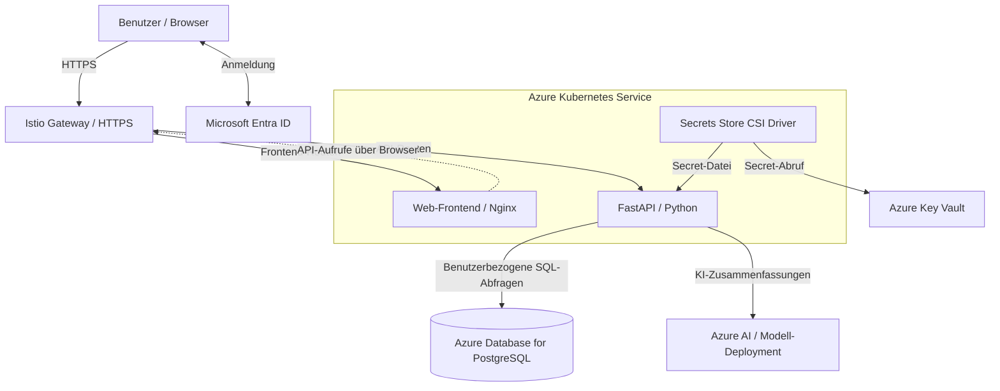

# LearningSteps – Technische Architektur

## 1. Architekturübersicht

LearningSteps ist eine cloudnative Lernjournal-Anwendung auf Microsoft Azure. Die Infrastruktur wird mit Terraform definiert, die Anwendung läuft containerisiert im Azure Kubernetes Service (AKS).

Die Architektur verbindet ein öffentlich erreichbares Web-Frontend mit einer authentifizierten FastAPI, einer PostgreSQL-Datenbank und einer KI-gestützten Lernzusammenfassung.

### Architekturdiagramm



*Das Diagramm zeigt die logischen Kommunikationswege, nicht die vollständige physische Netzwerktopologie. Die API-Aufrufe des Frontends erfolgen aus dem Browser über das Gateway.*

## 2. Azure-Infrastruktur

| Komponente | Aufgabe |
|---|---|
| Resource Group | Gemeinsame Verwaltung der Projektressourcen |
| Virtual Network | Netzwerkinfrastruktur für die Azure-Dienste |
| Azure Kubernetes Service | Orchestrierung der Anwendungscontainer |
| Azure Container Registry | Speicherung der Container-Images |
| Azure Database for PostgreSQL | Persistente Speicherung der Lernnotizen |
| Azure Key Vault | Verwaltung von Secrets |
| Azure AI | KI-gestützte Lernzusammenfassung |
| Managed Identities | Authentifizierung von Workloads gegenüber Azure |
| Log Analytics | Zentrale Speicherung von Logs und Monitoring-Daten |
| Azure Monitor / Container Insights | Überwachung von AKS und Containern |

Die Infrastrukturdefinitionen befinden sich unter `infra-terraform/`.

### Netzwerksegmentierung und private Azure-Dienste

Die Azure-Infrastruktur verwendet das Virtual Network `vnet-learningsteps-weu` mit dem Adressbereich `10.30.0.0/16`.

| Subnetz | Adressbereich | Funktion |
|---|---|---|
| `snet-aks` | `10.30.1.0/24` | AKS-Infrastruktur |
| `snet-postgres` | `10.30.2.0/24` | PostgreSQL Flexible Server |
| `snet-private-endpoints` | `10.30.3.0/24` | Private Endpoints für Key Vault und Backup-Storage |

#### PostgreSQL

Die Anwendung verwendet Azure Database for PostgreSQL Flexible Server, Version 16.

Der Server ist über ein delegiertes Subnetz in das Virtual Network integriert. Öffentlicher Netzwerkzugriff ist deaktiviert.

Für die private Namensauflösung wird die DNS-Zone `learningsteps.postgres.database.azure.com` verwendet.

Die Datenbankkonfiguration umfasst:

- PostgreSQL 16
- SKU `B_Standard_B1ms`
- 32 GiB Storage
- Sieben Tage verwaltete Backup-Aufbewahrung
- Datenbank `learning_journal`

#### Azure Key Vault

Der Azure Key Vault ist über den Private Endpoint `pe-learningsteps-keyvault` mit dem LearningSteps-VNet verbunden.

Die private Namensauflösung erfolgt über `privatelink.vaultcore.azure.net`.

Die API greift mithilfe ihrer Azure Workload Identity und des Secrets Store CSI Drivers auf benötigte Secrets zu.

Die Terraform-Konfiguration definiert folgende Sicherheitsmaßnahmen:

- Öffentlicher Netzwerkzugriff deaktiviert
- Netzwerk-Standardregel `Deny`
- Kein Trusted-Services-Bypass (`None`)
- RBAC-basierte Autorisierung aktiviert
- Soft Delete mit sieben Tagen Aufbewahrung

**Purge Protection ist deaktiviert.** Das erleichtert die vollständige Bereinigung der temporären Lernumgebung, reduziert jedoch den Schutz vor endgültigem Löschen durch entsprechend privilegierte Identitäten.

Für eine produktive Umgebung wäre Purge Protection vorzuziehen.

#### Backup-Storage

Das Storage Account `stlstepsbackup305c3ba6` wurde für Wartungs- und Migrationsaufgaben angelegt.

Der Blob-Zugriff erfolgt über einen Private Endpoint und die DNS-Zone `privatelink.blob.core.windows.net`.

Implementierte Sicherheitseinstellungen:

- Öffentlicher Netzwerkzugriff deaktiviert
- HTTPS erforderlich und mindestens TLS 1.2
- Shared-Key-Authentifizierung deaktiviert
- Keine Freigabe öffentlicher Blob-Unterelemente
- Netzwerkzugriff standardmäßig verweigert
- Kein Trusted-Azure-Services-Bypass

Der Storage verwendet LRS und besitzt eine Löschaufbewahrung von sieben Tagen für Blobs und Container.

Die vorhandenen Einstellungen ersetzen keinen nachgewiesenen Wiederherstellungstest.

#### Wartungsnetz

Für Wartungs- und Migrationsaufgaben existiert das Subnetz `snet-maintenance` mit dem Adressbereich `10.30.4.0/27`.

Das Subnetz ist mit der Network Security Group `nsg-learningsteps-maintenance` verknüpft.

Eine explizite Sicherheitsregel mit Priorität 100 verweigert sämtlichen eingehenden Netzwerkverkehr.

Es existiert keine zusätzliche explizite Egress-Deny-Regel. Die Wartungsumgebung darf deshalb nicht als vollständig vom übrigen Netzwerk isoliert betrachtet werden.

Die Wartungs-VM und der private Backup-Storage werden über separate Terraform-Konfigurationen verwaltet.

#### Sicherheitsgrenzen

Die Architektur verwendet mehrere Sicherheitsmechanismen:

- **Netzwerksegmentierung:** Getrennte Subnetze für AKS, PostgreSQL, Private Endpoints und Wartungsaufgaben.
- **Private Azure-Verbindungen:** PostgreSQL über VNet-Integration sowie Key Vault und Backup-Storage über Private Endpoints.
- **Kubernetes NetworkPolicies:** Beschränkung eingehender Verbindungen zur API und zum Frontend.
- **Identitätsbasierte Zugriffskontrolle:** Microsoft Entra ID, Azure Workload Identity und Azure RBAC.
- **Container-Härtung:** Nicht privilegierte Benutzer, schreibgeschütztes Root-Dateisystem und reduzierte Linux Capabilities.

Die Verwendung unterschiedlicher Subnetze bedeutet nicht automatisch, dass sämtliche Verbindungen zwischen ihnen blockiert sind.

Verbleibende Einschränkungen sind insbesondere:

- Keine vollständige restriktive Kubernetes-Egress-Filterung.
- Deaktivierte Purge Protection des Azure Key Vault.
- Keine zusätzliche explizite Egress-Deny-Regel für das Wartungsnetz.
- Noch kein vollständig nachgewiesener Disaster-Recovery-Prozess.

Diese Punkte werden in der Sicherheitsdokumentation gesondert bewertet.

### HTTPS-Routing

Der öffentliche Einstiegspunkt verwendet ein Kubernetes Gateway der Klasse `approuting-istio`.

- HTTPS-Port: `443`
- TLS-Terminierung am Gateway
- Weiterleitung von `/api` an den API-Service
- Weiterleitung von `/` an den Web-Service
- Umschreibung des API-Pfadpräfixes `/api` zu `/`
- HTTPRoutes ausschließlich aus demselben Kubernetes-Namespace zugelassen

Die Gateway-Konfiguration definiert keine durchgehende TLS-Verschlüsselung zwischen Gateway und Backend.

### Azure Workload Identity

Die API verwendet eine dedizierte User Assigned Managed Identity namens `id-learningsteps-api`.

Das Federated Identity Credential ist an folgenden Kubernetes-ServiceAccount gebunden:

`system:serviceaccount:learningsteps:learningsteps-api`

Als Audience ist `api://AzureADTokenExchange` konfiguriert.

Die Managed Identity besitzt die Rolle `Key Vault Secrets User` auf dem zugehörigen Azure Key Vault. Weitere Azure-Berechtigungen werden separat in den Terraform-Konfigurationen definiert.

Dadurch muss die Anwendung für den Azure-Zugriff keine langlebigen Azure-Service-Principal-Secrets speichern.

## 3. Kubernetes-Architektur

Die Anwendung wird im Namespace `learningsteps` betrieben.

### Web-Frontend

Das Frontend basiert auf JavaScript und MSAL. Nginx stellt die statischen Webdateien bereit.

Die Anmeldung erfolgt über Microsoft Entra ID. Für geschützte API-Anfragen verwendet das Frontend ein Zugriffstoken.

### API

Das Backend verwendet Python und FastAPI.

Zu seinen Aufgaben gehören:

- Validierung der Zugriffstokens
- Benutzerbezogene CRUD-Operationen
- Kommunikation mit PostgreSQL
- Aufruf des Azure-AI-Modells
- Bereitstellung von Healthcheck-Endpunkten

### Gateway

Ein Istio-basiertes Kubernetes Gateway übernimmt den öffentlichen HTTPS-Zugriff und leitet Anfragen anhand ihrer Pfade an das Frontend oder die API weiter.

### Skalierung

Für die API ist ein Horizontal Pod Autoscaler konfiguriert. Die Skalierung erfolgt anhand der CPU-Auslastung innerhalb der festgelegten Replikagrenzen.

## 4. Authentifizierung und Autorisierung

### Benutzeridentität

Microsoft Entra ID übernimmt die Benutzeranmeldung.

Die API prüft eingehende Bearer-Tokens, bevor sie geschützte Operationen ausführt.

### Datenisolation

Lernnotizen sind einem Benutzer zugeordnet.

Datenbankabfragen für die KI-Zusammenfassung verwenden einen parametrisierten Filter auf die Benutzerkennung:

```sql
WHERE owner_id = $1
```

Die Benutzerkennung wird aus dem authentifizierten Kontext abgeleitet.

Ein zusätzlicher Integrationstest mit zwei unterschiedlichen Benutzerkonten ist noch vorgesehen.

### Azure Workload Identity

Für den Zugriff auf Azure-Dienste werden Managed Identities und föderierte Workload-Identitäten eingesetzt.

Dadurch können Workloads Azure-Zugriffstokens beziehen, ohne statische Azure-Zugangsschlüssel im Anwendungscode zu speichern.

## 5. Secrets und Datenbank

Die API erhält das PostgreSQL-Passwort über eine vom Secrets Store CSI Driver bereitgestellte Datei.

Die Kubernetes-ConfigMap enthält lediglich den Dateipfad:

```yaml
DB_PASSWORD_FILE: "/mnt/secrets/postgres-admin-password"
```

Das Passwort selbst wird nicht als Klartext in der ConfigMap hinterlegt.

Die Anwendung verwendet einen PostgreSQL-Connection-Pool. Der Readiness-Endpoint prüft die Datenbankverbindung durch eine `SELECT 1`-Abfrage.

## 6. Azure-AI-Integration

Die KI-Zusammenfassung wird über den geschützten API-Endpunkt `POST /entries/summary` gestartet.

Der Ablauf:

1. Die API authentifiziert den Benutzer.
2. Sie lädt dessen Lernnotizen aus PostgreSQL.
3. Sie prüft die maximale Anzahl und begrenzt die Textlängen.
4. Sie übermittelt die ausgewählten Notizinhalte an das Azure-AI-Modell.
5. Die generierte Zusammenfassung wird an das Frontend zurückgegeben.

Die Funktion besitzt einen Konfigurationsschalter:

```yaml
AI_SUMMARY_ENABLED: "true"
```

Die Anwendung verwendet einen System-Prompt, der Notizinhalte ausdrücklich als nicht vertrauenswürdige Daten behandelt.

Dies reduziert Prompt-Injection-Risiken, ersetzt aber keine technische Zugriffskontrolle.

## 7. Kubernetes-Sicherheitsmaßnahmen

Die produktiven Anwendungspods verwenden unter anderem:

- Nicht privilegierte Benutzer
- Schreibgeschützte Root-Dateisysteme
- Deaktivierte Privilege Escalation
- Entfernte Linux Capabilities
- Seccomp `RuntimeDefault`
- Begrenzte beschreibbare temporäre Verzeichnisse

Kubernetes NetworkPolicies beschränken eingehende Verbindungen zur API und zum Frontend auf die vorgesehenen Gateway-Workloads.

Ausgehende Verbindungen sind nicht vollständig durch restriktive Egress-Policies abgesichert. Das ist eine verbleibende Einschränkung.

## 8. Healthchecks

Die API stellt zwei Endpunkte bereit:

| Endpoint | Aufgabe |
|---|---|
| `/health/live` | Überprüft, ob FastAPI antwortet |
| `/health/ready` | Überprüft FastAPI und die PostgreSQL-Verbindung |

Die Readiness-Probe wird alle 15 Sekunden ausgeführt und toleriert einen fehlgeschlagenen Versuch.

Die Liveness-Probe läuft alle 20 Sekunden und löst nach drei aufeinanderfolgenden Fehlern einen Container-Neustart aus.

## 9. CI/CD und Supply Chain Security

GitHub Actions übernimmt automatisierte Qualitäts- und Sicherheitsprüfungen.

Die Workflows befinden sich in `.github/workflows/`.

Die CI-Pipeline umfasst unter anderem:

- Python-Tests und Codeanalyse
- Trivy Secret Scanning
- Terraform-Sicherheitsprüfungen
- Kubernetes-Konfigurationsprüfungen
- Kubeconform-Schema-Validierung
- Container-Build und Schwachstellenscans

Die Bereitstellung verwendet Azure-Identitäten und GitHub-OIDC-Föderation, um langlebige Azure-Credentials möglichst zu vermeiden.

Die konkreten Ausführungsbedingungen und Deployment-Schritte sind in den Workflow-Dateien dokumentiert.

## 10. Monitoring

Für das AKS-Monitoring werden Azure Monitor, Container Insights und Log Analytics genutzt.

Erfasst werden:

- `ContainerLogV2`
- `KubePodInventory`
- `InsightsMetrics`

Die Datenerfassung wurde durch Log-Analytics-Abfragen überprüft.

Für API- und Web-Container wurden bei den bisherigen Prüfungen keine zusätzlichen Neustarts innerhalb des untersuchten Zeitfensters festgestellt.

Eine KQL-basierte Alarmbedingung mit drei Zuständen wurde getestet:

| Wert | Zustand |
|---|---|
| 0 | Laufender API-Container erkannt |
| 1 | Kein laufender API-Container erkannt |
| 2 | Keine aktuellen Inventardaten erkannt |

Die Terraform-Datei `alerts.tf` enthält einen vorbereiteten, deaktivierten Alarm. Die Ressource wurde bisher nicht in Azure bereitgestellt.

## 11. Bekannte Einschränkungen

- Kein vollständiger Cross-User-Autorisierungstest mit zwei Entra-Konten.
- Kein aktivierter automatischer Azure-Monitor-Alert.
- Keine automatisierte externe HTTPS-Verfügbarkeitsprüfung.
- Keine vollständige restriktive Egress-Kontrolle.
- Die Kubernetes-Inventardaten beweisen nicht unmittelbar die tatsächliche Readiness.
- Ein vollständiger Disaster-Recovery-Test ist noch nicht dokumentiert.

## 12. Zugehörige Konfiguration

| Bereich | Repository-Pfad |
|---|---|
| Infrastruktur | `infra-terraform/` |
| Kubernetes | `k8s-manifests/` |
| API | `api/` |
| Frontend | `web/` |
| Tests | `tests/` |
| CI/CD | `.github/workflows/` |

Diese Dokumentation beschreibt die überprüfte logische Architektur. Konkrete Netzwerkadressen, RBAC-Zuweisungen und Deployment-Abläufe werden anhand der jeweiligen Terraform- und Kubernetes-Konfiguration weiter präzisiert.