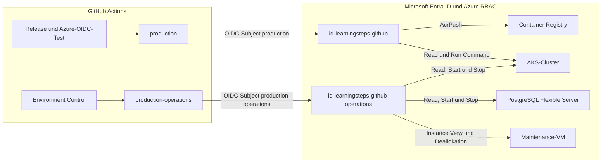

# IAM-Architektur für GitHub Actions und Azure

LearningSteps verwendet zwei benutzerzugewiesene Managed Identities für GitHub
Actions. Die Release-Identity veröffentlicht Container-Images und kann das
API-Deployment auf AKS aktualisieren. Die Operations-Identity liest die
Betriebszustände und steuert Start und Stop der dafür vorgesehenen Ressourcen.
Terraform verwaltet beide Azure-Identitäten, ihre Federated Credentials und
die direkten RBAC-Zuweisungen. GitHub verwaltet die Environments und ihre
Freigaberegeln.

## Identitäten und Vertrauensgrenzen

| Identität | GitHub-Environment | Verbraucher |
| --- | --- | --- |
| `id-learningsteps-github` | `production` | Release-Workflow und manueller Azure-OIDC-Test |
| `id-learningsteps-github-operations` | `production-operations` | Manueller Environment-Control-Workflow für `status`, `start` und `stop` |

Die Zuordnung ist in [Release-IAM](../infra-terraform/github-identity.tf) und
[Operations-IAM](../infra-terraform/github-environment-identity.tf) definiert.
Die Kubernetes Workload Identity der Anwendung ist ein eigener
[Terraform-Baustein](../infra-terraform/workload-identity.tf).



### OIDC-Federation

Die Azure-Jobs fordern mit `id-token: write` ein kurzlebiges GitHub-OIDC-Token
an. `azure/login@v3` tauscht es über die Federated Credential der jeweiligen
Managed Identity gegen eine Azure-Anmeldung. Die Workflows lesen
`AZURE_CLIENT_ID`, `AZURE_TENANT_ID` und `AZURE_SUBSCRIPTION_ID` aus dem
jeweiligen Environment. Diese Variablen identifizieren das Anmeldeziel.
Ein dauerhaftes Azure-Client-Secret ist für diesen Anmeldepfad nicht erforderlich.
[GitHub-OIDC-Referenz](https://docs.github.com/en/actions/reference/security/oidc)

Beide Credentials erwarten den Issuer `https://token.actions.githubusercontent.com`
und die Audience `api://AzureADTokenExchange`. Das Subject enthält die
numerischen GitHub-IDs von Owner und Repository. Die Platzhalter unten stehen
für die in Terraform hinterlegten Werte.

```text
repo:TraceWatcher@<owner-id>/learningsteps-devsecops@<repo-id>:environment:production
repo:TraceWatcher@<owner-id>/learningsteps-devsecops@<repo-id>:environment:production-operations
```

Das Environment bildet den Unterschied zwischen den beiden Subjects. Ein
Job-Token für `production` passt daher nicht zur Credential für
`production-operations`. Der Subject-Filter bindet Azure an Repository und
Environment. Eine bestimmte Workflow-Datei ist darin nicht codiert. Die
GitHub-Environment-Regeln und die Job-Konfiguration steuern, wann ein Job
den jeweiligen Kontext nutzt.

### GitHub-Environment-Schutz

Die GitHub-REST-Konfiguration beider Environments wurde lesend geprüft.

| Environment | Erlaubte Git-Refs laut Environment-Regel | Freigabe |
| --- | --- | --- |
| `production` | Branch `main` und Tags mit Muster `v*` | Ein Required Reviewer, Selbstfreigabe erlaubt, Administrator-Bypass deaktiviert |
| `production-operations` | Ausschließlich Branch `main` | Genau `TraceWatcher` als Required Reviewer, Selbstfreigabe erlaubt, Administrator-Bypass deaktiviert |

Der [Release-Workflow](../.github/workflows/release.yml) verlangt zusätzlich
einen Tag der Form `vMAJOR.MINOR.PATCH`, einen Commit in der Historie von
`main` und einen erfolgreichen CI-Push-Lauf für genau diesen Commit auf
`main`. Der [manuelle OIDC-Test](../.github/workflows/oidc-test.yml) nutzt
ebenfalls `production` und setzt einen `v`-Tag voraus. Er ist als
Anmelde- und AKS-Run-Command-Prüfung vorgesehen.

[Environment Control](../.github/workflows/environment.yml) lässt den
Preflight nur auf `main` laufen. Die Repository-Variable
`OPERATIONS_ENVIRONMENT_ID` bindet den Workflow an das manuell eingerichtete
Environment. Das [Prüfskript](../scripts/check-operations-environment.sh) verlangt
den passenden Namen und, im Workflow, die erwartete ID. Es prüft genau eine
Branch-Regel für `main`, den festgelegten Reviewer einschließlich seiner
numerischen Benutzer-ID, `prevent_self_review: false` und
`can_admins_bypass: false`. Der Operations-Job wiederholt die Prüfungen vor der
Azure-Anmeldung. `stop` erfordert zusätzlich die Eingabe `STOP`.
Release und Environment Control verwenden dieselbe Concurrency-Gruppe.

## Azure-RBAC-Berechtigungsmatrix

Die Matrix beschreibt die in Terraform definierten **direkten** Zuweisungen.
Ein Strich bedeutet, dass diese Konfiguration der Identität auf der Ressource
keine direkte Rolle zuweist.

| Ressource und Zuweisungsscope | Release-Identity | Operations-Identity |
| --- | --- | --- |
| LearningSteps Container Registry | Integrierte Rolle `AcrPush` für Push und Pull | — |
| LearningSteps AKS-Cluster | Custom Role `LearningSteps AKS Command Deployer` für Cluster-Read und Run Command | Custom Role `LearningSteps Environment Operator` für Cluster-Read, Start und Stop |
| LearningSteps PostgreSQL Flexible Server | — | `LearningSteps Environment Operator` für Server-Read, Start und Stop |
| LearningSteps Maintenance-VM | — | `LearningSteps Environment Operator` für Instance View und Deallokation |

Beide Custom Roles verwenden die LearningSteps-Resource-Group als
`assignable_scopes`. Dieser Wert macht die Rollendefinition dort für
Zuweisungen verfügbar. Zugriff entsteht erst durch die jeweilige Zuweisung
am Registry-, Cluster-, Server- oder VM-Scope. Die Custom Roles enthalten
explizite Azure-Managementaktionen und keine `DataActions`.
[Azure-RBAC-Scopes](https://learn.microsoft.com/en-us/azure/role-based-access-control/scope-overview)

Die integrierte Rolle `AcrPush` umfasst
`Microsoft.ContainerRegistry/registries/pull/read` und
`Microsoft.ContainerRegistry/registries/push/write`.
[Azure-Rollendefinition für AcrPush](https://learn.microsoft.com/en-us/azure/role-based-access-control/built-in-roles/containers#acrpush)

| Custom Role | Hinterlegte Azure-Aktion | Zweck |
| --- | --- | --- |
| AKS Command Deployer | `Microsoft.ContainerService/managedClusters/read` | Clusterinformationen lesen |
| AKS Command Deployer | `Microsoft.ContainerService/managedClusters/runCommand/action` | Kubernetes-Befehle über den AKS-Dienst ausführen |
| AKS Command Deployer | `Microsoft.ContainerService/managedClusters/commandResults/read` | Ergebnis von Run Command abrufen |
| Environment Operator | `Microsoft.ContainerService/managedClusters/read` | AKS-Betriebszustand und Provisioning-Status lesen |
| Environment Operator | `Microsoft.ContainerService/managedClusters/start/action` | AKS starten |
| Environment Operator | `Microsoft.ContainerService/managedClusters/stop/action` | AKS stoppen |
| Environment Operator | `Microsoft.DBforPostgreSQL/flexibleServers/read` | PostgreSQL-Serverzustand lesen |
| Environment Operator | `Microsoft.DBforPostgreSQL/flexibleServers/start/action` | PostgreSQL-Server starten |
| Environment Operator | `Microsoft.DBforPostgreSQL/flexibleServers/stop/action` | PostgreSQL-Server stoppen |
| Environment Operator | `Microsoft.Compute/virtualMachines/instanceView/read` | VM-Betriebszustand direkt am Instance-View-Endpunkt lesen |
| Environment Operator | `Microsoft.Compute/virtualMachines/deallocate/action` | Maintenance-VM deallokieren |

AKS Run Command ist auf den Cluster begrenzt und ermöglicht dort die
Ausführung von Kubernetes-Befehlen. Der Azure-RBAC-Scope begrenzt diese
Befehle nicht auf den Namespace oder das Deployment, die der Release-Workflow
verwendet. Dessen Deployment-Schritt ist zusätzlich über
`ENABLE_AKS_AUTO_DEPLOY` gesteuert.
[AKS Run Command](https://learn.microsoft.com/en-us/azure/aks/access-private-cluster)

Das [Operations-Skript](../scripts/control-environment.sh) startet PostgreSQL
vor AKS. Beim Stop hält es zuerst AKS und PostgreSQL an und deallokiert danach
bei Bedarf die VM. Die schreibenden Azure-Aufrufe verwenden `--no-wait`.
Anschließend prüft das Skript die Zielzustände an den jeweiligen Ressourcen.
Unerwartete Zustände, Rücksprünge, Autorisierungsfehler und Zeitüberschreitungen
brechen die Sequenz ab. Der `start`-Pfad enthält außerdem HTTPS-Statusprüfungen
der Anwendung. Die VM wird durch diesen Workflow nicht gestartet.

## Automatisierte Prüfungen und Wiederherstellung

- [CI](../.github/workflows/ci.yml) führt Sync- und Operations-Tests mit
  `az`- und `gh`-Stubs aus. Sie decken unter anderem falsche OIDC-Subjects,
  fehlende oder zu breite Rollenzuweisungen, eine fremde Subscription in
  der Rollen-ID, falsche Reviewer sowie Abbrüche bei Timeout oder
  Autorisierungsfehler ab. CI prüft außerdem Python und die
  PostgreSQL-Integration, scannt Secrets, Terraform, Kubernetes und das
  Container-Image mit Trivy und validiert Kubernetes-Manifeste mit Kubeconform.
  [Sync-Tests](../scripts/test-sync-github-azure-identity.py) ·
  [Operations-Tests](../scripts/test-control-environment.py)
- [Release](../.github/workflows/release.yml) prüft die CI-Freigabe,
  führt die Sync-Tests erneut aus und scannt das gebaute Image vor dem
  Push. Die Tests laufen ohne produktive Azure-Autorisierung.
- Das [Synchronisationsskript](../scripts/sync-github-azure-identity.sh)
  prüft Client-, Tenant- und Subscription-Zuordnung, GitHubs ID-basiertes
  OIDC-Format sowie Issuer, Subject und Audience. Für den Release-Modus
  prüft es den ACR-Berechtigungsmodus, `AcrPush` am Registry-Scope und
  die erforderlichen AKS-Aktionen einschließlich Wildcards und
  `NotActions`. Im Operations-Modus prüft es die Environment-Regeln,
  genau eine Federated Credential, die exakte Aktionsliste und genau
  drei direkte, unbedingte Zuweisungen. Dabei vergleicht es den
  vollständigen Azure-Rollenpfad einschließlich Subscription und fragt
  sichtbare Zuweisungen auf Subscription-Ebene und darüber ab.

Nach einem Infrastruktur-Rebuild stellt Terraform die Rollenbindungen anhand
der aktuellen Principal- und Ressourcen-IDs wieder her. Die Client-IDs können
sich dabei ändern. In [Recovery-Phase C2](RECOVERY.md#c2-github-oidc-aktualisieren)
prüft der Betreiber beide Environments getrennt. Voraussetzung für Operations
sind das manuell geschützte Environment sowie korrekte Tenant-, Subscription-
und Server-Variablen.

```bash
bash scripts/sync-github-azure-identity.sh --check
bash scripts/sync-github-azure-identity.sh --operations --check
```

`--check` arbeitet lesend. Exit-Code `0` steht für eine gültige Konfiguration
mit aktueller Client-ID, `1` für eine Abweichung und `2` für einen technischen
Fehler. Wenn nur die Client-ID fehlt oder veraltet ist, kann der Betreiber den
betroffenen Modus ohne `--check` ausführen. Das Skript aktualisiert dann
`AZURE_CLIENT_ID` im jeweiligen Environment und liest die Variable zur
Bestätigung zurück. Azure-RBAC und GitHub-Environment-Regeln werden in diesem
Schritt geprüft. Die Wiederherstellung läuft als expliziter Schritt nach dem
Provisioning.

## Nachweise aus GitHub Actions

Alle drei Läufe endeten erfolgreich auf `main` beim Commit `df839cc`.
Der CI-Lauf belegt Tests und statische Prüfungen. Die beiden Operations-Läufe
belegen den erfolgreichen Environment-Preflight mit Workflow-Token, den
OIDC-Login mit der Operations-Identity und die unten genannten Azure-Aufrufe
beziehungsweise beobachteten Zustände.

| Lauf | Art des Nachweises | Beobachtung |
| --- | --- | --- |
| [CI 45380683083](https://github.com/TraceWatcher/learningsteps-devsecops/actions/runs/45380683083) | Automatisierte Tests und statische Prüfungen | Sync- und Operations-Tests, Python/PostgreSQL sowie Secret-, IaC-, Kubernetes- und Image-Prüfungen erfolgreich |
| [Operations Status 45383025377](https://github.com/TraceWatcher/learningsteps-devsecops/actions/runs/45383025377) | Live-Lesetest | AKS meldete `Stopped`, PostgreSQL `Ready` und die VM `PowerState/deallocated`. Damit sind alle drei Statusabfragen einschließlich des direkten VM-Instance-View-Reads belegt. |
| [Operations Stop 45384746186](https://github.com/TraceWatcher/learningsteps-devsecops/actions/runs/45384746186) | Live-Stop-Lauf | Die Stop-Bestätigung war erfolgreich. Das Protokoll enthält die PostgreSQL-CLI-Warnung zum automatischen Wiederanlauf und meldet den Server danach als `Stopped`. AKS und VM meldeten die Zielzustände. |

AKS und VM waren schon beim vorangegangenen Statuslauf im Zielzustand.
Das Stop-Protokoll weist für sie keine einzelnen Start-/Stop- oder
Deallokationsaufrufe aus. Belegt sind ihre beobachteten Endzustände.

## Sicherheitsgrenzen

- **Selbstfreigabe.** Der einzige Repository-Betreiber kann einen selbst
  ausgelösten Lauf als benannter Reviewer freigeben. Die manuelle Freigabe
  bleibt erforderlich. Eine unabhängige zweite Genehmigung ist damit nicht
  gegeben.
- **Offene Lifecycle-Tests.** Die ausgewerteten Läufe belegen keinen
  Live-Start von AKS oder PostgreSQL und keine explizite Ausführung von
  AKS-Stop oder VM-Deallokation. Die Bereitschaftsprüfungen nach einem
  Live-Start sind ebenfalls offen. Die in der Matrix aufgeführten
  Release-Rechte sind aus der Konfiguration abgeleitet. Die drei Läufe
  belegen weder einen ACR-Push noch ein AKS-Deployment durch die Release-Identity.
- **Indirekte Rechte.** Die direkten Terraform-Zuweisungen und die beim
  Sync sichtbaren Azure-RBAC-Daten sind keine vollständige Ermittlung
  effektiver Rechte. Je nach Sichtbarkeit und Scope können weitere
  Gruppenzuweisungen oder Vererbung außerhalb des geprüften Bereichs
  bestehen.
- **Negativer RBAC-Test.** Die Tests simulieren abgelehnte Azure-Aufrufe.
  Ein gezielter Live-Aufruf mit erwarteter Azure-RBAC-Ablehnung ist bislang
  nicht belegt.
